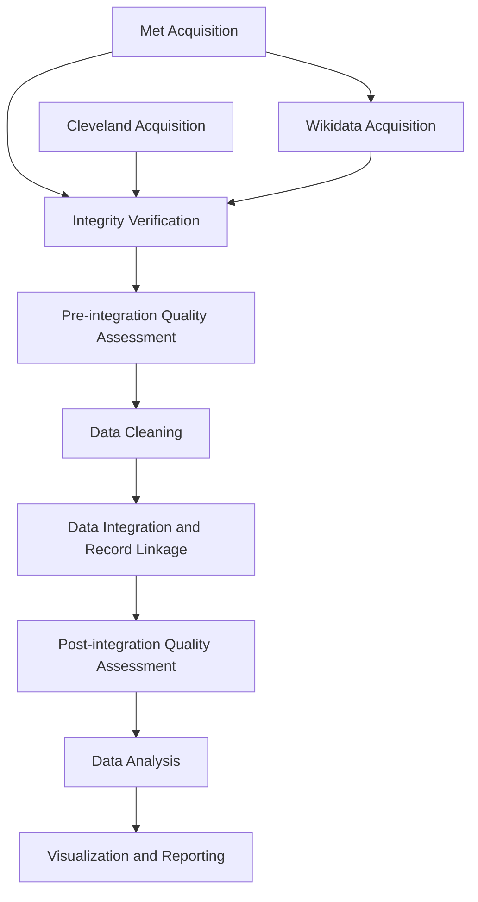

# Museum Data Integration Workflow

## Workflow Overview

## Workflow Orchestration

The project uses `run_all.py` to coordinate
separate Python scripts.

### Currently Implemented

- Acquisition script orchestration
- Existing dataset detection
- SHA-256 integrity verification
- Error handling and failure reporting
- Dependency ordering between Met and Wikidata

### Pending Implementation

- Pre-integration quality assessment
- Data cleaning
- Data integration and record linkage
- Post-integration quality assessment
- Data analysis and visualization

## Current Issue

The Wikidata dataset checksum does not match
the recorded SHA-256 value.

The issue has been identified during workflow
testing and requires confirmation of the
correct dataset snapshot and checksum.

## Future Development

Additional scripts will be integrated after
their interfaces, inputs, and outputs have
been confirmed with the team.

The final workflow will support reproducible
execution from a fresh GitHub clone.
